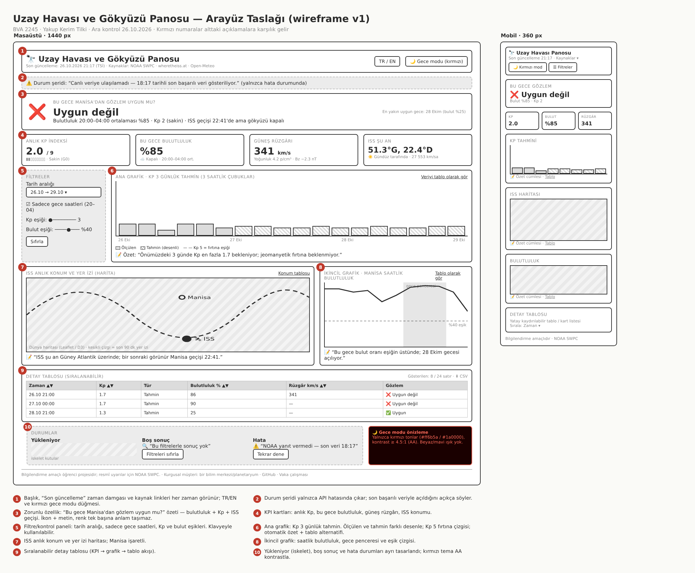
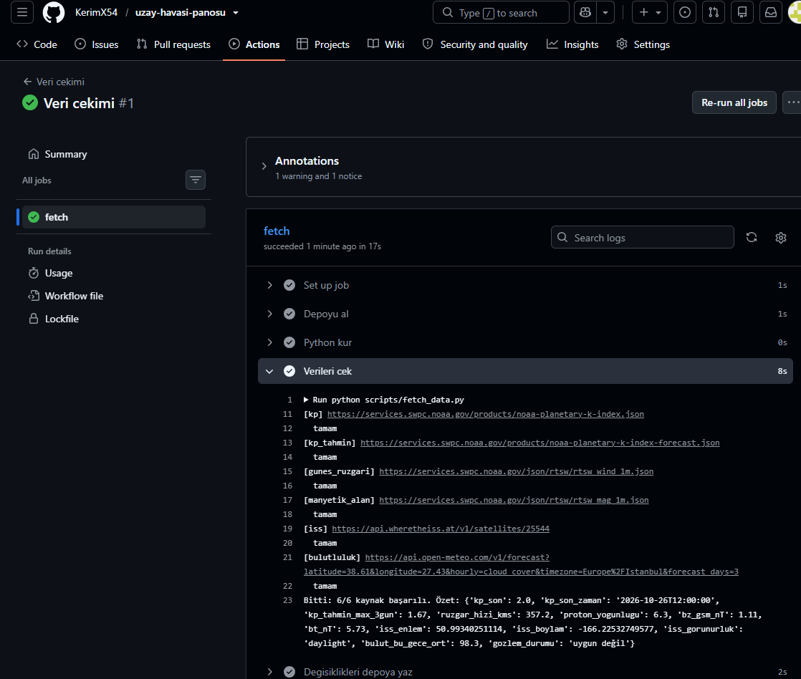
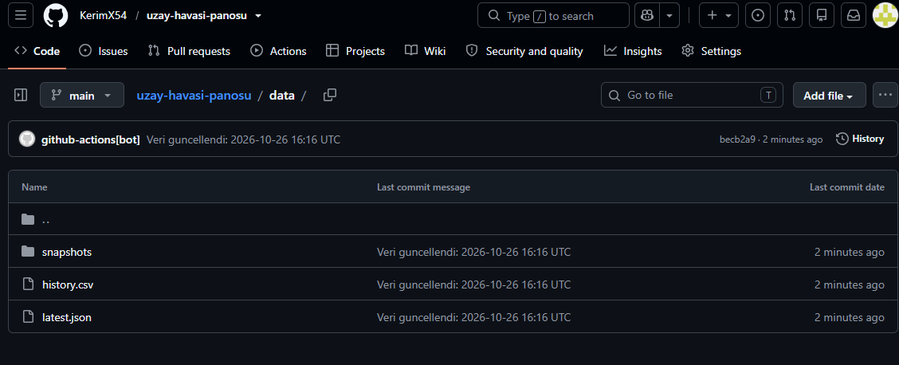
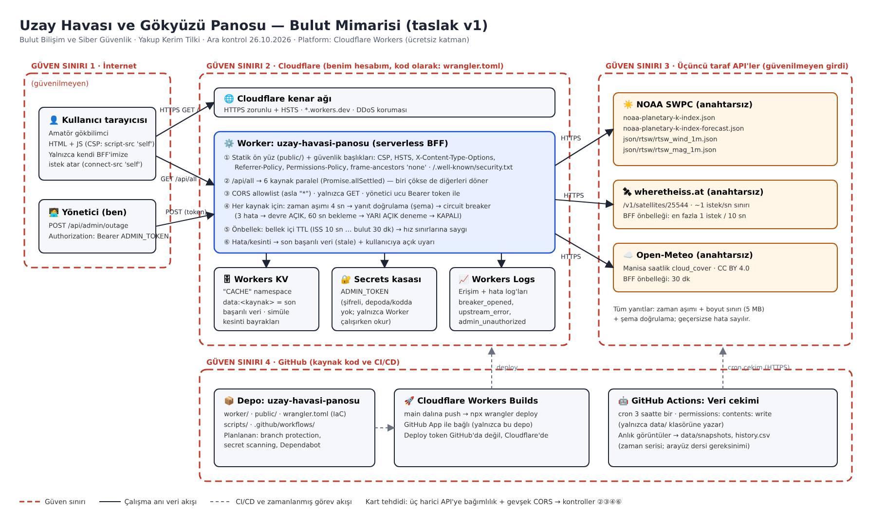
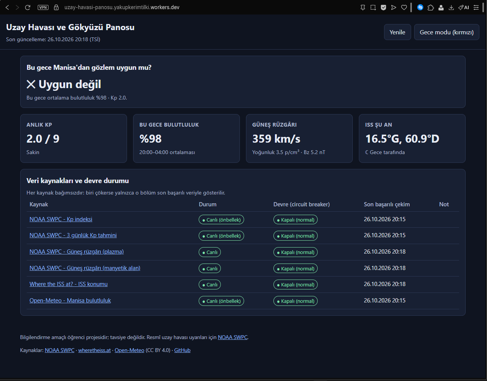
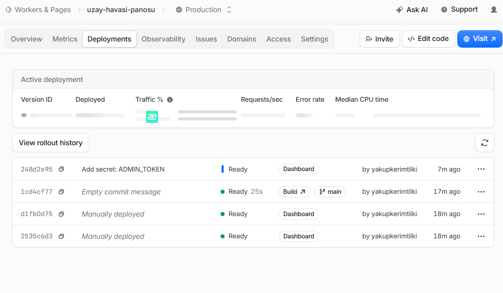
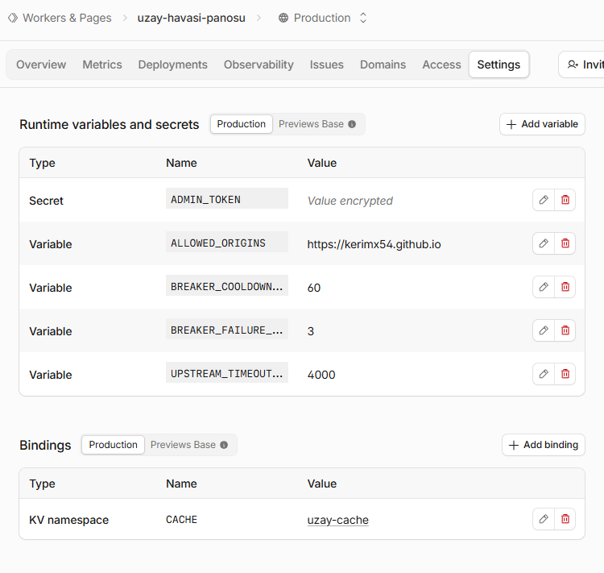
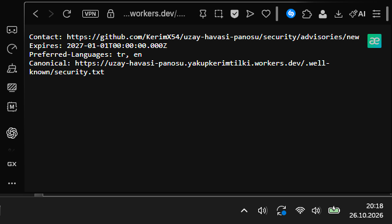

# Uzay Havası ve Gökyüzü Panosu

Amatör gökbilimcilerin gözlem gecesi planlamasına yardım eden canlı veri panosu.
Kp indeksi ve 3 günlük tahmini, güneş rüzgârı, ISS'in anlık konumu ve Manisa'nın bulutluluk
tahminini bir araya getirerek "Bu gece Manisa'dan gözlem uygun mu?" sorusunu yanıtlar.

> BVA 2245 Kullanıcı Arayüzü Tasarımı ile Bulut Bilişim ve Siber Güvenlik dersleri için hazırlanmış bir öğrenci projesidir
> (iki ders aynı ürün ve aynı depo üzerinde ilerler).
> Müşteri (bir bilim merkezi/planetaryum) kurgusaldır; ürün herhangi bir kurumun resmî aracı değildir.

**Canlı link:** https://uzay-havasi-panosu.yakupkerimtilki.workers.dev

| Klasör / dosya | Ders |
| --- | --- |
| `public/`, `scripts/`, `.github/workflows/` | Kullanıcı Arayüzü Tasarımı (arayüz, veri hattı) |
| `worker/`, `wrangler.toml`, `docs/mimari-diyagram.png` | Bulut Bilişim ve Siber Güvenlik (BFF, IaC, güvenlik) |

## Durum

- [x] Otomatik veri hattı (GitHub Actions, 3 saatte bir)
- [x] Anlık görüntü (snapshot) birikimi
- [x] Cloudflare Workers'ta yayın: BFF (CORS allowlist, zaman aşımı, circuit breaker, yanıt doğrulama, KV önbellek)
- [x] Güvenlik başlıkları (CSP, HSTS vb.), `security.txt`, gizli anahtar Cloudflare Secrets'ta
- [ ] Arayüz: KPI kartları, grafikler, ISS haritası, tablo
- [ ] Kırmızı gece modu
- [ ] Yükleniyor / boş / hata durumları
- [ ] Kullanıcı testi
- [ ] Portfolyo vaka sayfası ve demo videosu

## Mimari

```
NOAA SWPC (Kp, Kp tahmini, güneş rüzgârı)  ─┐
wheretheiss.at (ISS konumu)                 ├─> GitHub Actions (cron, 3 saatte bir)
Open-Meteo (Manisa bulutluluğu)            ─┘        │  scripts/fetch_data.py
                                                     ▼
                                   data/latest.json   (son veri + özet)
                                   data/snapshots/    (anlık görüntüler)
                                   data/history.csv   (biriken zaman serisi)
                                                     │
                                                     ▼
                                   (zaman serisi / geçmiş grafikleri)

Tarayıcı ──HTTPS──> Cloudflare Worker (BFF + statik ön yüz) ──HTTPS──> NOAA SWPC · wheretheiss.at · Open-Meteo
                         │  zaman aşımı → yanıt doğrulama → circuit breaker
                         └─ Workers KV (son başarılı veri) · Secrets (ADMIN_TOKEN) · Workers Logs
```

Ayrıntılı diyagram ve güven sınırları: [`docs/mimari-diyagram.png`](docs/mimari-diyagram.png)

Bir kaynak yanıt vermezse önceki başarılı verisi korunur ve `"ok": false` olarak işaretlenir;
arayüz bu durumda son başarılı veriyle açılıp kullanıcıya bunu bildirir.

## Veri kaynakları ve lisanslar

| Kaynak | Ne için | Lisans / kullanım |
| --- | --- | --- |
| [NOAA SWPC](https://www.swpc.noaa.gov/) – `noaa-planetary-k-index.json`, `noaa-planetary-k-index-forecast.json`, `rtsw_wind_1m.json`, `rtsw_mag_1m.json` | Kp indeksi, 3 günlük tahmin, güneş rüzgârı | ABD kamu verisi (public domain) |
| [Where the ISS at?](https://wheretheiss.at/w/developer) | ISS anlık konumu | Ücretsiz API, ~1 istek/sn sınırı |
| [Open-Meteo](https://open-meteo.com/) | Manisa saatlik bulutluluk | CC BY 4.0, ticari olmayan kullanımda anahtarsız |

Hiçbir kaynak API anahtarı gerektirmez.

## Kurulum

```bash
git clone https://github.com/KerimX54/uzay-havasi-panosu.git
cd uzay-havasi-panosu
python scripts/fetch_data.py   # Python 3.10+, ek paket gerekmez
```

Bulut yayını: `main` dalına her push'ta Cloudflare Workers Builds `npx wrangler deploy` çalıştırır
(altyapı `wrangler.toml` içinde kod olarak tanımlıdır; `ADMIN_TOKEN` Cloudflare Secrets'ta tutulur, depoda yoktur).

## CV cümlesi

_(final teslimde eklenecek)_

## Ara kontrol kanıtları (26.10.2026)

### Kullanıcı Arayüzü Tasarımı
**Arayüz taslağı (wireframe):**



**İlk otomatik veri çekimi (GitHub Actions, 6/6 kaynak başarılı):**



**Depoda biriken veri ve anlık görüntüler:**



### Bulut Bilişim ve Siber Güvenlik
**Mimari diyagram taslağı:**



**Bulutta yayında:** https://uzay-havasi-panosu.yakupkerimtilki.workers.dev





**Gizli anahtar kasada (Cloudflare Secrets, değer şifreli):**



**security.txt yayında:**



## Yapay zekâ kullanım beyanı

- **Claude (Anthropic):** ödev metinlerinin adımlara ayrılması; API adreslerinin kontrolü; `scripts/fetch_data.py`,
  `.github/workflows/fetch.yml`, `worker/index.js`, `wrangler.toml` ve `public/` dosyalarının ilk taslağı;
  arayüz taslağı ve mimari diyagram görsellerinin hazırlanması.
- **Benim yaptıklarım:** _(final teslimden önce kendi cümlelerimle eklenecek: hangi çıktıyı nasıl kontrol ettim/değiştirdim)_
